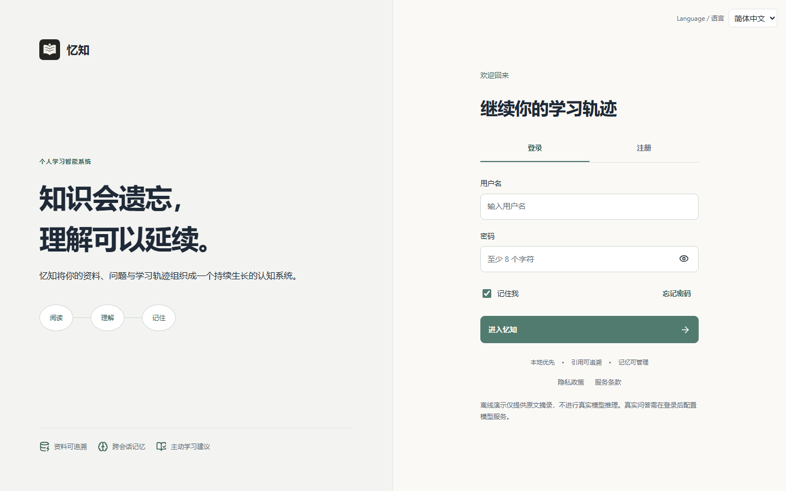
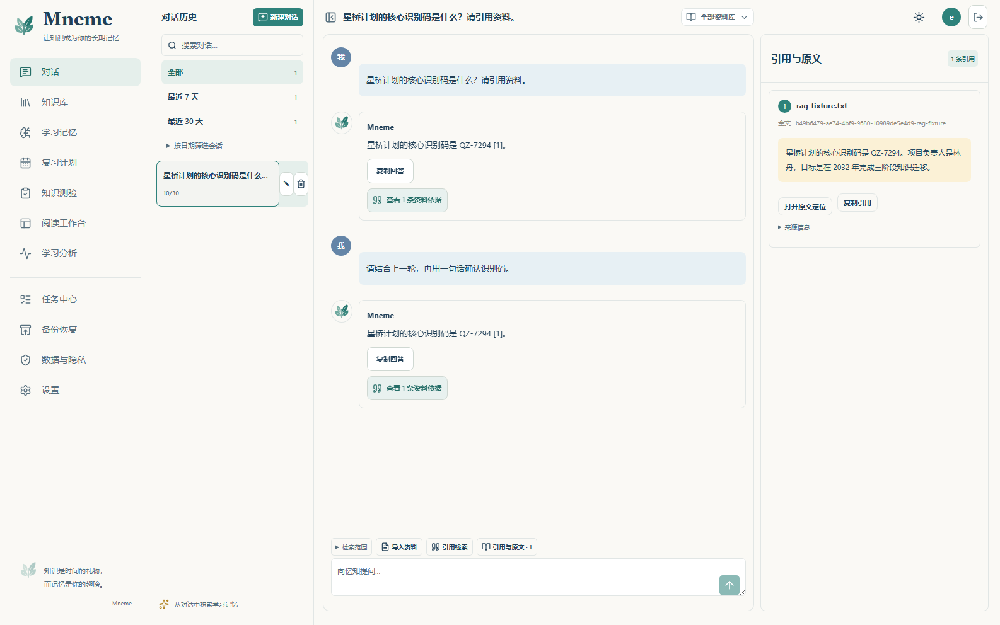
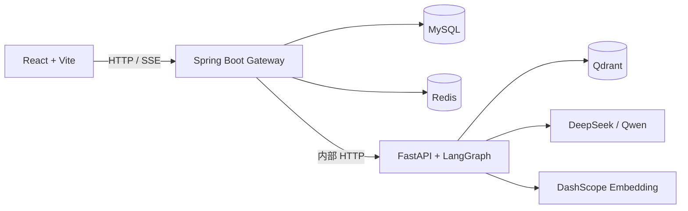

# Mneme

> 一个支持结构化 RAG、三级记忆与可追溯引用的开源个人学习助手。


[](https://github.com/CoderDongHuang/Mneme/actions/workflows/ci.yml)


Mneme 面向需要长期学习和资料管理的用户。它不仅回答单次问题，还会从对话中沉淀表达偏好、知识薄弱点和学习进度，并在后续回答与复习建议中使用这些记忆。

> 当前状态：面向个人与小规模团队的本地自部署 Beta 版本。核心学习闭环、中文 OCR、本地邮件、RAG 评测和真实全链路验收入口均已提供；图表与流程图理解按需启用多模态模型。[收尾状态与已知边界](docs/PROJECT_STATUS.md)。

## 解决什么问题

资料分散、对话缺少出处、复习难以持续时，Mneme 把文件检索、原文引用、可编辑测验和间隔复习放进同一工作区。它面向个人私有部署，回答仍需核对证据，不承诺消除幻觉。

## 30 秒了解演示

无需模型密钥：注册本地账号 → 上传固定合成资料 → 问“星桥计划的核心识别码是什么” → 打开引用 → 在设置中检测运行配置。演示回答明确标为**原文摘录**，不模拟 AI 推理；首次镜像下载和构建需要数分钟。

## 快速开始：无外部 API 的离线演示

需要 Git、Python 3.10+、正在运行的 Docker 与 Compose v2；建议 4 核、8 GB 内存、20 GB 可用磁盘。在 PowerShell、Bash 中均可运行：

```bash
git clone https://github.com/CoderDongHuang/Mneme.git
cd Mneme
python scripts/demo.py start
```

打开 <http://localhost:3000/auth>，注册账号并上传 `test-fixtures/rag-fixture.txt`，等待“可检索”后提问。本地重置邮件位于 <http://localhost:8025>。脚本生成仅供演示的随机密钥，使用独立 `mneme-demo` 容器和卷，不读取正式 `.env`。

```bash
python scripts/demo.py status
python scripts/demo.py logs
python scripts/demo.py stop
# 仅在确认不再需要演示数据时执行
python scripts/demo.py clean --confirm-delete-demo-data
```

端口冲突、无 Docker、测试与清理见 [完整离线演示指南](docs/DEMO.md)。需要真实模型时按后文 Docker 自部署配置独立实例；演示索引不能直接冒充云端模型索引。

## 界面预览




截图展示已有工作区。最新离线演示的实际截图由 `Offline demo clean install` CI 产物保存。

## 功能概览

- **账号与工作区**：注册、登录、资料库、对话历史、个人资料和学习工作台。
- **结构化 RAG**：支持 PDF、DOCX、PPTX、XLSX/XLSM、CSV、Markdown（`.md`/`.markdown`）、TXT 和 HTML。
- **复杂文档解析**：PDF 版面块排序、中英文 OCR、独立表格提取，可选 Qwen-VL；逐页文本/表格/chunk 预览与 OCR 区域置信度叠加，部分成功和取消重试可追踪。
- **可追溯回答**：保留文档名、页码、章节、原文、文件 SHA-256 和解析器版本；引用核验后展示，并按 hash 打开对应历史版本。
- **联合检索筛选**：知识库、指定文档、标签和导入日期共同限定范围；聊天与检索调试均可使用。
- **回归证据**：[路线图对照](docs/ROADMAP_COVERAGE.md)与[实际运行验收](docs/ACCEPTANCE_2026-10-29.md)，包含已通过和未达标项。
- **Agent 决策链**：LangGraph 编排意图识别、条件检索、个性化推理和记忆回写。
- **三级记忆**：工作记忆、短期会话记忆、长期偏好/薄弱点/进度记忆。
- **记忆质量控制**：高置信度自动写入，中置信度由用户确认，低置信度丢弃。
- **流式输出**：Python 生成 SSE，Java Gateway 转发，React 前端逐步渲染。
- **模型容错**：DeepSeek 主模型与 Qwen 备用模型，支持失败切换、熔断和恢复探测。

## 系统架构



浏览器只访问 Java Gateway。Java 负责认证、业务数据和服务编排；Python 负责 Agent 推理、RAG 与语义记忆；MySQL 是业务事实来源，Redis 与 Qdrant 分别承载短期状态和向量数据。

## Docker 自部署

### 环境要求

- Docker Desktop，或 Docker Engine + Compose v2
- DeepSeek API Key
- DashScope API Key（Embedding 必需，同时可用于 Qwen 备用模型）
- 建议至少 4 核 CPU、8 GB 内存和 20 GB 可用磁盘

### 1. 获取项目

```bash
git clone https://github.com/CoderDongHuang/Mneme.git
cd Mneme
cp .env.example .env
```

Windows PowerShell 使用：

```powershell
Copy-Item .env.example .env
```

### 2. 配置 `.env`

至少修改以下配置，数据库密码、JWT 密钥和内部服务令牌不要复用：

```dotenv
DEEPSEEK_API_KEY=你的_deepseek_key
DASHSCOPE_API_KEY=你的_dashscope_key
MYSQL_ROOT_PASSWORD=一个强数据库密码
SPRING_DATASOURCE_PASSWORD=与上面相同
JWT_SECRET=至少32字节随机字符串
INTERNAL_SERVICE_TOKEN=另一个至少32字节随机字符串
```

### 3. 启动完整项目

```bash
docker compose -f docker-compose.yml -f docker-compose.selfhost.yml up -d --build
```

启动完成且 `frontend`、`java-gateway` 均为 `running` 后，打开 <http://localhost:3000>。
这是本机地址，不是公网演示站；若浏览器打不开，请先确认 Docker Desktop 已启动，并运行下面的状态检查命令。

密码重置邮件保存在本机 Mailpit，访问 <http://localhost:8025> 查看，无需配置公网 SMTP。

```bash
# 查看状态
docker compose -f docker-compose.yml -f docker-compose.selfhost.yml ps

# 查看日志
docker compose -f docker-compose.yml -f docker-compose.selfhost.yml logs -f

# 停止服务（保留数据）
docker compose -f docker-compose.yml -f docker-compose.selfhost.yml down
```

数据默认保存在 `data/mysql`、`data/redis`、`data/qdrant` 和 `data/files`。不要使用 `down -v`，除非确认要删除数据。

更完整的配置、OCR 和故障排查见 [Docker 自部署指南](docs/SELF_HOSTING.md)。需要域名与 HTTPS 时再使用 [公网部署说明](docs/PRODUCTION_DEPLOYMENT.md)。

## 本地开发

本地调试可让 Docker 只运行 MySQL、Redis 和 Qdrant，再分别启动 Python、Java 和 React：

```powershell
docker compose -f docker-compose.yml -f docker-compose.selfhost.yml up -d mysql redis qdrant
./start.bat
```

详细环境与命令见 [开发与启动](docs/development.md)。

## 测试

```bash
# Python
cd python-agent
pip install --require-hashes -r requirements.lock
pip install -r requirements-dev.txt
python -m pytest tests -q
ruff check .

# Java
cd ../java-gateway
mvn test

# Frontend
cd ../frontend
npm ci
npm run lint
npm test
npm run build
```

CI 会分别执行 Python、Java 和前端检查，并使用 mock API 验证关键交互与响应式布局。仓库另有需要显式启用的真实模型 E2E，覆盖注册、上传、解析、检索、流式回答与引用，运行方式见 [测试说明](docs/testing.md)。

## 文档索引

- [架构设计说明书](架构设计说明书.md)
- [Docker 自部署指南](docs/SELF_HOSTING.md)
- [项目设计与实现博客](docs/MNEME_PROJECT_BLOG.md)
- [接口契约](docs/api.md)
- [文档解析与 RAG](docs/rag.md)
- [前端设计](docs/frontend.md)
- [测试说明](docs/testing.md)
- [配置获取与参数说明](docs/SELF_HOSTING.md#2-配置与获取方式)
- [ADR：服务与数据边界](docs/adr/0001-service-and-data-boundaries.md)
- [项目审计与迭代路线图](docs/PROJECT_AUDIT_AND_ROADMAP.md)
- [当前项目状态与已知边界](docs/PROJECT_STATUS.md)

`全阶段开发步骤.md` 和 `调试问题记录.md` 是历史过程记录，不代表当前实现状态。

## 使用边界

- 默认模式优先使用本地版面解析和 OCR；图表、公式、图片与流程图需要设置 `MULTIMODAL_ENABLED=true`，会消耗 DashScope 多模态额度。
- Qdrant 与本地文件目录针对个人和小规模自部署设计，正好覆盖本项目当前定位。
- Mailpit 是本地测试邮箱，不会向真实邮箱投递；验证码在 `http://localhost:8025` 查看。
- 设置页支持每位用户独立保存和测试对话模型，密钥加密持久化且不回显。Embedding、OCR 与后台任务仍使用部署方配置；切换 Embedding 必须迁移索引。
- 引用会经历编号、声明支持判定和逐字引文核验；模型核验失败时拒答。核验增加延迟和调用费用，仍不能证明语义绝对正确。
- 向量存储改为 Qdrant 1.20.0，移除旧 Chroma 三项扫描例外；Spring 已升级到 7.0.10。旧数据须按[迁移指南](docs/VECTOR_STORE_MIGRATION.md)显式迁移。扫描通过不代表零漏洞。

## 路线图与贡献

通用工程与 Mneme 第一章见 [路线图落实记录](docs/ROADMAP_COVERAGE.md)；最新全界面、个人模型、独立复习/测验与双层恢复验收见 [界面整改记录](docs/FRONTEND_REVIEW_20261029.md)。升级前阅读 [发布说明](docs/RELEASE_NOTES_2026-10-29.md)、[迁移流程](docs/rollout.md) 和 [宿主机灾备配置](docs/HOST_RECOVERY.md)。优先完善真实资料评测与恢复可靠性；暂不扩张为公网多租户 SaaS。

提交问题请使用 [Bug / 功能建议模板](https://github.com/CoderDongHuang/Mneme/issues/new/choose)，附环境、复现步骤和脱敏日志。提交代码请先阅读 [开发指南](docs/development.md)，为实际行为增加回归，说明迁移及兼容性；MIT 仅覆盖本仓库代码，第三方依赖和模型仍遵守各自许可证与服务条款。

## 开源协议

本项目采用 [MIT License](LICENSE)。
