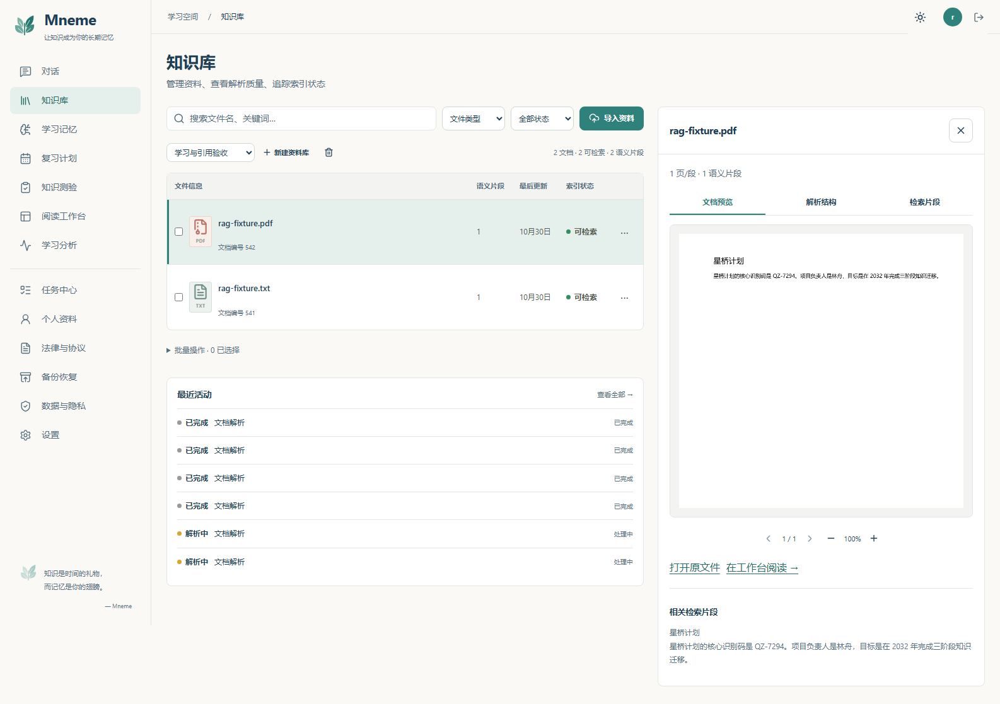
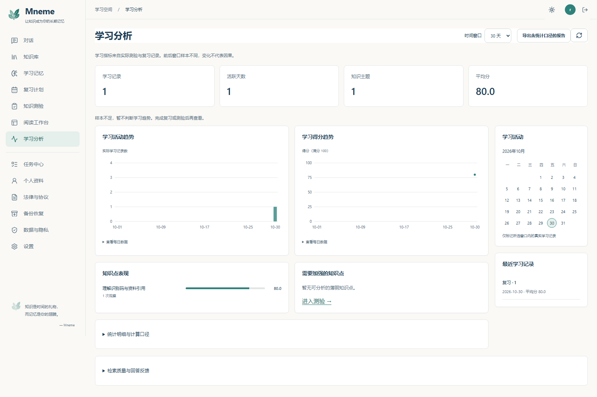
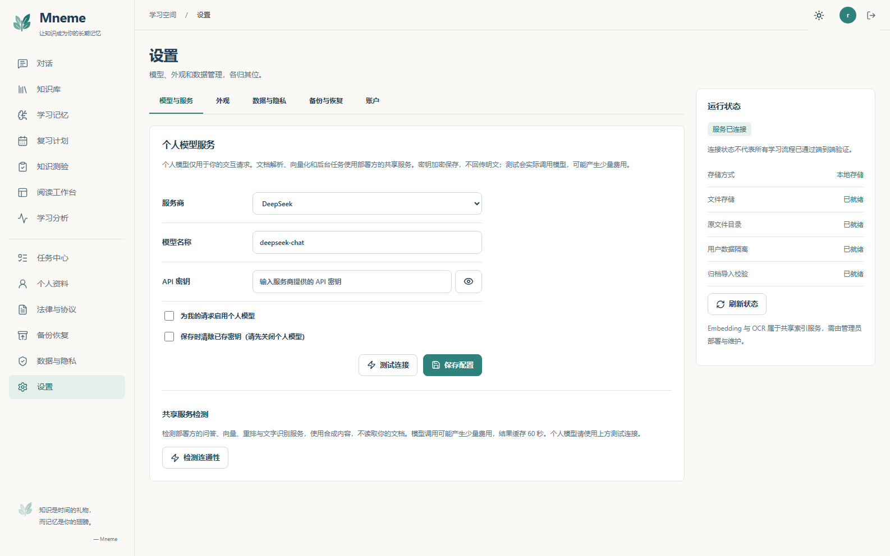

# 2026-10-30 参考图还原与回归记录

本轮依据用户提供的两份界面 DOCX 及后续确认修正上一轮布局差距。原文档不修改，图片优先于正文中的蓝色建议。统一使用暖白、低饱和青绿、Mneme 名称与书叶标志。

## 页面对应与实现

| 页面 | 参考 | 已实施结构及保留能力 |
| --- | --- | --- |
| 对话、阅读工作台 | 第二份文档第 2 节对话图，1586×992 | 主导航、历史、聊天、引用四区；小页头、底部输入、原文卡片。阅读工作台的原文阅读、检索调试、分支对比由工具菜单打开，保留版本和页码深链。 |
| 知识库 | 第一份报告知识库图，1586×992 | 紧凑工具栏、文件表格、选中状态、并排原文预览和最近活动。上传、版本、重新解析、OCR、删除能力保留。 |
| 学习记忆 | 第二份文档记忆图，1672×941 | 四张摘要卡、分类筛选、连续表格、右侧记忆详情和来源；编辑、确认、归档和删除保留。 |
| 复习、测验 | 第二份文档学习图，1672×940 | 学习卡片、进度、周历和即将复习；复习翻面评分、测验选择与填空、串行草稿保存、历史和反馈保留。 |
| 任务 | 第二份文档任务图，1585×992 | 摘要卡、任务表、活动时间线、右侧详情；错误阶段、重试和运行中取消保留。 |
| 设置、数据与隐私 | 第二份文档设置图，1586×992 | 横向标签、横排字段、主题选项、配置状态和数据操作；个人模型密钥、偏好和隐私能力保留。 |
| 学习分析 | 第二份文档分析图，1672×941 | 摘要、活动柱图、得分折线、知识点和薄弱项、右侧活动日历。图表附可访问明细表，导出与反馈保留。 |

桌面布局以 240px 导航、258px 历史和 380px 引用为基准，正文自动分配剩余空间。后续统一界面批次将引用/知识库详情抽屉断点调整到 1279px，全局导航为 1100px，聊天历史为 819px。面板打开时提供焦点管理和背景隔离；816px 窄窗口与手机单独检查。

用户补充统一实施方案与四页总览图后，认证、注册、个人资料、恢复、管理员运维及法律页已完成专属布局。最新实现、截图与测试结果见 [统一界面验收记录](UNIFIED_UI_ACCEPTANCE_20261030.md)。以下测试数字保留本轮早期核心页面批次的历史语境。

## 数据与行为边界

- 参考图中的示例数字和文档不写入产品。截图使用真实服务中新建的合成验收账号、文档、记忆和复习记录。
- 分析接口没有学习时长、阅读次数和成就字段，改用实际学习记录、活跃天数、主题、平均分及最近学习事件；不把观察趋势称为因果或真实留存率。
- 任务没有可信百分比时显示实际执行阶段。TXT 引用展示文字；PDF 预览展示实际页图，不给文字文件伪造缩略图。
- 修复 Java 入库任务未传原文件名导致引用显示存储 UUID 的问题；原名通过 `source_name` 传入 Python。兼容旧任务缺少字段的情况，已有索引不会被这次发布自动重写。
- 新增真实记忆样例时发现本地旧记忆集合缺少 Embedding profile，导致写入被拒绝。本轮暂停写入后保存原文/向量快照及 SHA-256，再按当前模型重建，保留原 ID、归属和正文。代码将此冲突返回为明确的迁移提示；其他部署仍须按 [迁移指南](EMBEDDING_MIGRATION.md) 操作，发布不会自动改写私人索引。
- GitHub 整栈复测发现新复习卡到期时间被数据库舍入到下一秒时，页面会停留在未到期状态。新增页面时钟更新，使卡片在到期后自动进入复习队列，无需刷新；用受控时间测试覆盖边界。
- 保留批量上传逐项错误、知识库加载错误、会话切换乱序保护、流式状态、记忆错误、向上阅读时不强制滚底，以及测验草稿和提交幂等行为。

## 验证记录

本地证据目录为 `artifacts/frontend-fidelity-20261030/`（不提交包含运行日志的整个目录）。测试数量是本批次记录，不表示未来提交自动通过。

| 范围 | 本轮结果 |
| --- | --- |
| 前端 lint、单元测试 | lint 通过；16 文件、49 项通过 |
| 生产构建 | 15 页面模块；初始 JS 82.18 KiB、CSS 8.77 KiB；聊天/工作台 JS 137.47/138.02 KiB，均在 140 KiB 门限内 |
| 普通浏览器回归 | 46 通过、16 明确跳过（真实栈/演示需单独启用） |
| 无障碍 | 桌面、移动端共 34 项通过；参考页面检查明暗主题，等待动效结束后检查对比度 |
| Java | 全量 90 项通过；包含原文件名传递与记忆索引冲突提示 |
| Python | 本机 655 通过、1 跳过（缺少本地 Tesseract）；ruff 通过 |
| 记忆迁移错误回归 | 新增冲突响应和既有迁移/回滚测试共 4 项通过，确认错误时没有修改原索引 |
| 真实布局矩阵 | 12 路由 × 5 宽度 × 2 语言 × 2 主题，240 组通过 |
| 真实学习及截图 | 复习评分、测验草稿恢复、记忆写入、PDF 原文预览通过；设置及分析等待实际数据加载后截图，人工核对宽屏与 816px 窄屏 |
| 真实个人数据 | 每用户模型配置隔离、中英文偏好持久化、个人 ZIP 导出与恢复通过 |
| 真实扩展工作流 | 八种格式、联合筛选、历史版本、租户隔离、复习/测验导出、删除、损坏 PDF、OCR、取消重试通过；工具菜单中的标签/检索筛选单独复测通过 |

真实服务入口为 `http://localhost:3000`。注册/登录、上传、入库、问答、引用、多轮与刷新，以及有数据的复习、测验和参考页面截图由 `real-stack.spec.js` 与 `report-stack.spec.js` 验证。局部样式对照和功能回归分别记录；无水平溢出和 axe 通过不能单独证明视觉还原。








## 复现与发布

启动既有自部署栈后，在 `frontend` 运行：

```powershell
$env:MNEME_REAL_E2E='true'
$env:MNEME_E2E_BASE_URL='http://localhost:3000'
npx playwright test e2e/real-stack.spec.js e2e/report-stack.spec.js e2e/roadmap-stack.spec.js --project=桌面端 --workers=1
```

真实模型模式会使用配置的服务处理合成资料并产生供应商费用。普通 mock 测试不能代替这一回归。GitHub 将实现与文档分批提交；最终合并状态以相应 PR 与提交检查为准。
