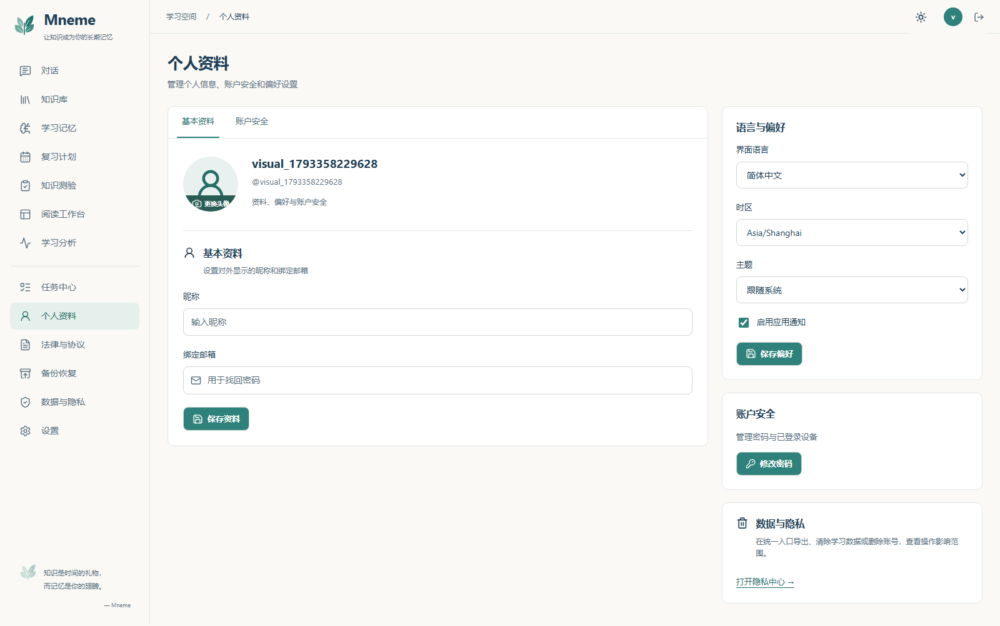
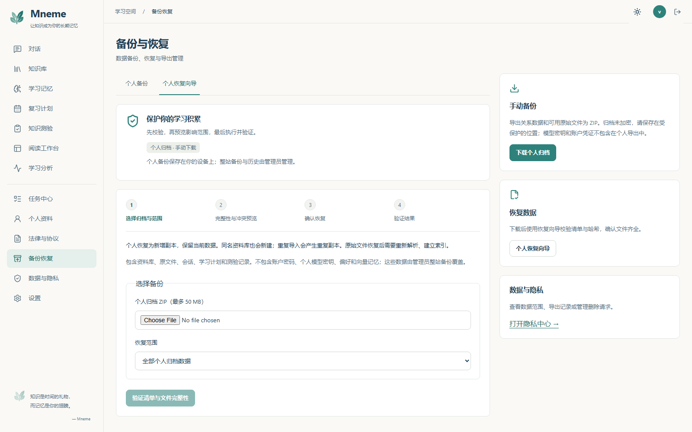
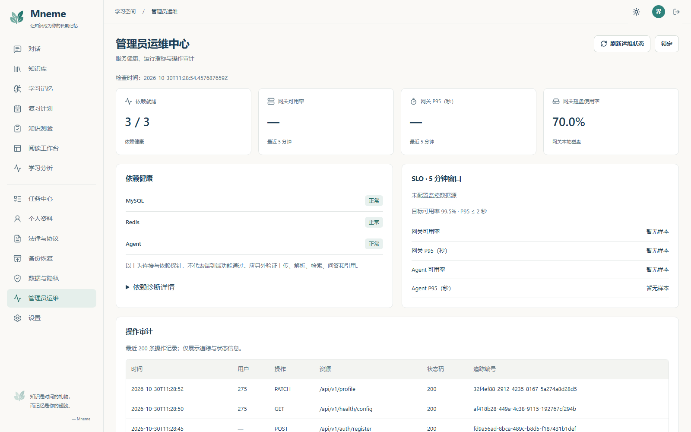
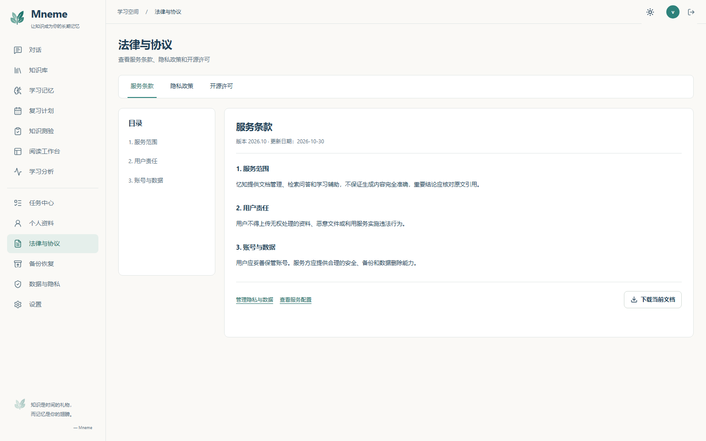
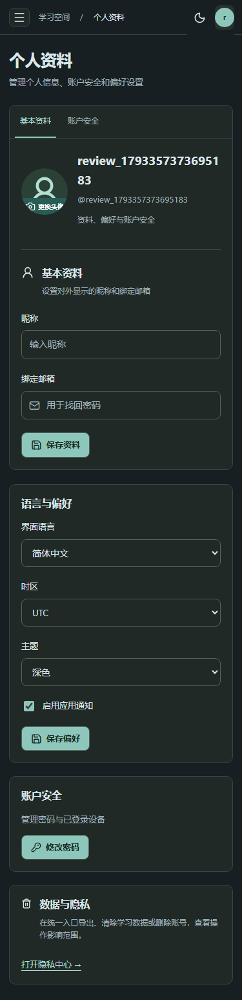

# 2026-10-30 统一界面验收记录

本批次依据《Mneme 统一界面设计与源码修改实施总方案》及个人资料、备份恢复、管理员运维、法律页总览图实施。按用户最终确认，图片中的暖白背景与青绿主色优先于正文蓝色建议。原始 DOCX、图片和用户审查记录不改写。

## 页面与参考图对应

| 页面 | 已落实结构 | 保留的真实能力 |
| --- | --- | --- |
| 登录 / 注册 / 重置 | 左侧品牌、四项功能说明、低饱和山景；右侧白色认证卡、登录注册标签 | 登录、长期会话、密码显示、重置邮件；注册确认密码与协议确认；失败后恢复按钮并保留输入 |
| 对话 / 阅读工作台 | 导航、历史、聊天、右侧引用；两页均依第二份文档对话图 | 真实引用、历史会话、流式回答、停止与重试；工作台工具菜单保留阅读、检索调试、分支对比 |
| 知识库 | 紧凑标题与工具栏、文件表格、右侧文档预览、最近活动 | 文件上传、版本、解析、OCR、筛选、删除及 PDF 实页预览 |
| 记忆 / 复习 / 测验 | 独立导航；摘要、连续列表、学习卡片与详情栏 | 记忆写入与确认、到期复习评分、测验草稿与反馈 |
| 任务 / 设置 / 隐私 / 分析 | 同一导航与页头、细边框、适度圆角、青绿交互色 | 任务状态、个人模型配置、偏好、数据操作和实际统计 |
| 个人资料 | 主区基本资料 / 安全标签、头像与表单；右侧偏好、安全、隐私 | 头像上传、昵称邮箱保存、密码修改、设备会话撤销、语言 / 时区 / 主题 / 通知持久化 |
| 备份恢复 | 主区标签、归档说明 / 导出记录 / 恢复向导，右侧备份、恢复、隐私入口 | ZIP 下载、校验、冲突预览、确认、新增副本恢复；管理员整站恢复和隔离演练入口保留 |
| 管理员运维 | 四张真实指标卡、依赖健康、SLO、审计表格；记录每页 10 条 | 临时凭证、刷新 / 锁定、容量限流、任务队列、告警、删除 Saga；分页保留全部已加载记录 |
| 法律与协议 | 横向文档标签、左目录、右正文、版本日期、下载按钮 | 服务条款、隐私政策、真实仓库 MIT 许可；公开访问与登录后工作区布局；不存在文档提示 |

宽屏检查使用 1440–1672px；自动布局矩阵使用 320、375、760、1024、1440px。引用和知识库详情在 ≤1279px 转抽屉，导航在 ≤1100px 收起，聊天历史在 ≤819px 收起。侧栏打开后有焦点隔离，Escape 关闭并恢复触发点。无横向溢出及 axe 通过不能单独证明视觉还原，因此同时检查实际截图的结构、密度、配色及状态。

## 样式未生效的根因与清理

`main.jsx` 原先先导入 App，再声明 CSS layer 顺序。打包后的组件层比基础层更早首次出现，旧基础规则因层顺序覆盖新组件主题。现在 `layers.css` 是入口第一条导入，明确 `reset, base, components, pages, utilities`。

- 主题变量集中到 `theme.css`，导航由 `app-shell.css` 管理，品牌由 `BrandLockup` 和 `brand.css` 管理。
- 保留唯一 `mneme-logo.svg`，删除重复叶片资源，更新 README 引用。
- 删除未使用的 `redesign.css`，清除旧知识库大标题、装饰编号、法律横排目录和多轮主题覆盖；原业务结构与 API 保留。
- 修复导航的延迟可见性导致初始焦点失败；长用户名可换行，320px 个人资料不再撑开页面。
- 实际审计有 200 条记录，原全量展开使页面过长；增加分页而不截断可访问数据。
- GitHub 干净安装发现前端 Docker 上下文缺少仓库 `LICENSE`，导致法律页导入失败。三个部署方案现使用仓库根上下文，由 Dockerfile 专属忽略文件仅纳入前端与许可证，保留单一许可证来源。

## 数据边界与部署配置

参考图片用于布局与视觉，不把示例值当成系统能力：

- 个人备份是手动 ZIP 下载；本次访问的导出记录不等于长期备份历史，也不证明用户设备已保存文件。整站归档由管理员恢复服务提供，不显示虚构的每日 02:00 / 保留 30 天配置。
- 运维卡片展示依赖就绪数、网关可用率、P95、网关本地磁盘使用率。未配置 Prometheus 时明确显示暂无样本；不将网关磁盘冒充全站容量，不虚构 CPU / 内存百分比或在线时长。
- 总览中的手机号、二次认证、用户管理没有对应现有 API；本批次沿用文档“不重写后端 / 不伪造数据”的边界，使用真实邮箱、会话安全、依赖健康与 SLO。它们不是本次新增能力。
- 管理员 API 同时校验 active 管理员角色和至少 32 字符的 `ADMIN_API_TOKEN`。凭证仅在页面内存中临时使用，不写入 localStorage；本地验收临时配置后已恢复原环境。正式管理员恢复还需部署对应 worker 或 GitHub 演练配置，见 [自部署指南](SELF_HOSTING.md) 与 [灾备说明](HOST_RECOVERY.md)。
- 本批次没有对用户正在使用的数据执行整站恢复。真实个人 ZIP 恢复在合成验收账号中执行，新增副本并核对记录。

## 本批次验证

实现提交 `942b528`，容器构建补充修复 `0b7f1fb`，实现 PR [#42](https://github.com/CoderDongHuang/Mneme/pull/42)。本表为当前批次实测，早期 Java / Python 数字仍保留在历史记录中，不作为此次本地重跑结果。

| 检查 | 结果 |
| --- | --- |
| ESLint | 通过 |
| Vitest | 16 文件、51 项通过，包括注册确认与运维分页 / 锁定 |
| 生产构建与预算 | 15 个延迟页面；初始 gzip JS 81.96 KiB、CSS 7.50 KiB；聊天 / 工作台 JS 137.01 / 137.54 KiB，低于 140 KiB |
| 常规 Playwright | 54 通过、16 跳过；跳过项为需要显式开启的真实服务 / 演示测试 |
| 无障碍子集 | 桌面 / 移动共 42 项通过；包含个人资料与三个法律文档的明暗主题检查 |
| 真实问答链路 | localhost:3000 注册、上传、入库、模型回答、引用、多轮、刷新与窄屏引用通过 |
| 真实个人数据 | 每用户模型配置隔离、双语持久化、ZIP 导出 / 校验 / 新增副本恢复通过 |
| 真实学习链路 | 复习翻面与评分、测验草稿重载、记忆写入、PDF 实页预览通过 |
| 布局矩阵 | 12 路由 × 5 宽度 × 2 语言 × 2 主题，共 240 组通过 |
| 管理员及账户补充 | 真实健康 3/3、审计分页、锁定、恢复入口、凭证不落本地存储通过；资料保存重载、账户安全入口、法律目录和下载内容通过 |
| Docker 干净安装 | GitHub 离线演示完整构建与工作流通过；本机重建因 npm 下载 `ECONNRESET` 未完成，未将其记为通过 |
| GitHub 整体检查 | [运行 41049645571](https://github.com/CoderDongHuang/Mneme/actions/runs/41049645571) 九项全部通过；覆盖前后端、Windows、OCR、供应链、分布式追踪、离线演示及真实全栈 / 整站恢复 |

文档要求的资料库失败保留与重试、切换请求乱序、会话最后请求生效、模型失败终态、停止、记忆确认失败防重均由既有测试继续验证。本轮未通过删掉断言或降低对比度要求解决问题。中途发现的长用户名溢出、导航焦点及主题层叠失败已修复后重测。

本地证据目录为 `artifacts/unified-ui-20261030/`，包括 `mock-final.log`、`unit-final.log`、`build-final.log`、`matrix-final.log`、`real-e2e.log`、`admin-qa-final.log`。原始真实测试日志包含首次矩阵失败，最终矩阵结果以 `matrix-final.log` 为准。只提交下列选定截图，不上传本地凭证、日志或完整浏览器 trace。

## 实际页面












对话、知识库、分析与设置截图见 [核心页面记录](FRONTEND_REFERENCE_20261030.md)，已同步本轮主题。

## 复现

在 `frontend` 目录运行 `npm run lint`、`npm test`、`npm run test:e2e`。真实自部署服务运行后：

```powershell
$env:MNEME_REAL_E2E='true'
$env:MNEME_E2E_BASE_URL='http://localhost:3000'
npx playwright test e2e/real-stack.spec.js e2e/report-stack.spec.js --project=桌面端 --workers=1
```

真实模型模式使用部署配置的供应商处理合成资料。实现 PR 的九项 GitHub 检查已全部通过，实现与文档分批发布；后续检查状态以 PR 页面为准。
